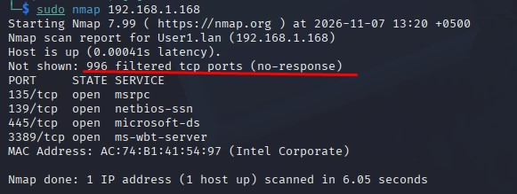
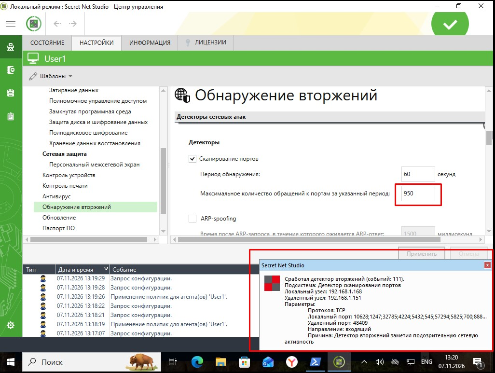
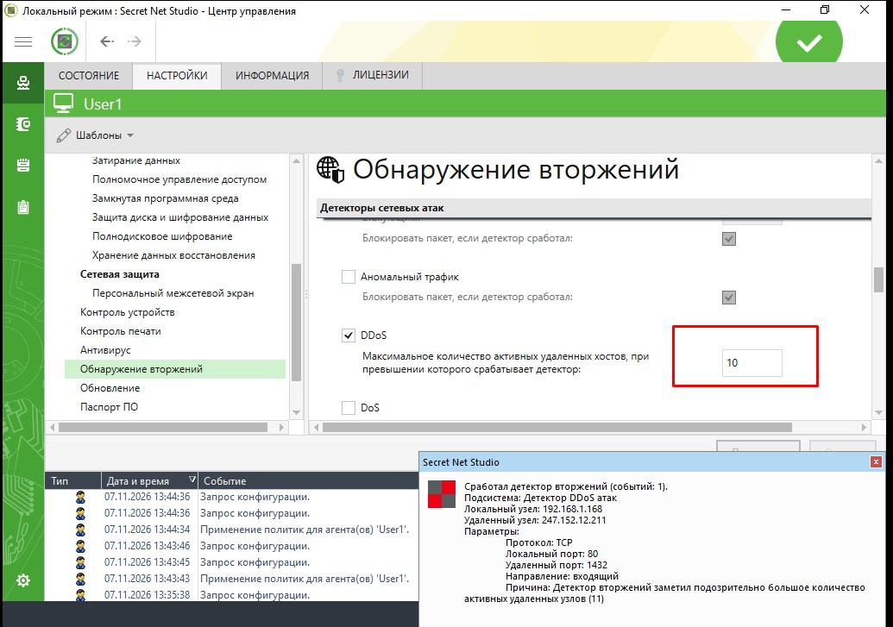

# Домашнее задание к занятию "IDS/IPS"

### Задание 1
Сканирование портов

### Решение 1  
Было замечено, что при использовании утилиты nmap без флагов она сканирует 996 портов.  
Опираясь на эту цифру и был выбран порог срабатывания детектора - т.е. если на нашей машине будут за минуту сканировать больше 950 портов, то мы получим alert от SNS, а также сможем заблокировать атакующий IP адрес.

  
  

---

### Задание 2
DDoS

### Решение 2  
Не совсем понятно каким образом утилита hping3 имитирует DDoS трафик. Если бы мы четко это знали, какое кол-во соединений с разных хостов будет генерировать утилита, можно было бы очень точно настроить детектор. Но изучив немного тему, точной информации я не получил, поэтому **опытным** путем было установлено, что детектор при использовании команды ```hping3 -S -p 80``` срабатывает при пороге 10 - при 12 уже не работает.
Для более тонкой и осознанной настройки данного случая надо глубже разобраться с тем, каким образом и за какой промежуток времени SNS оценивает одновременные подключения, а также как эти подключения генерируются hping3.  

  


