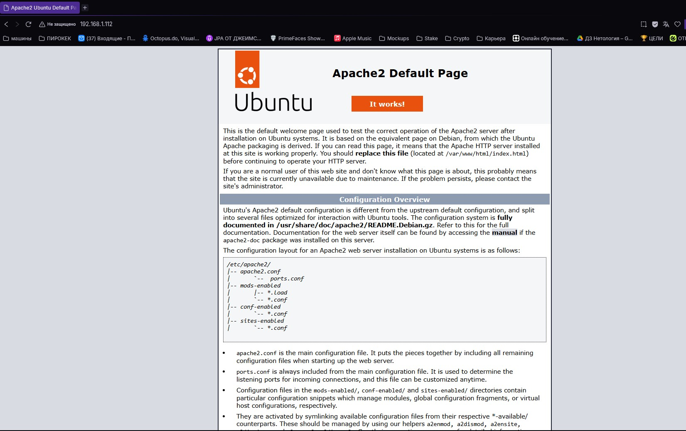
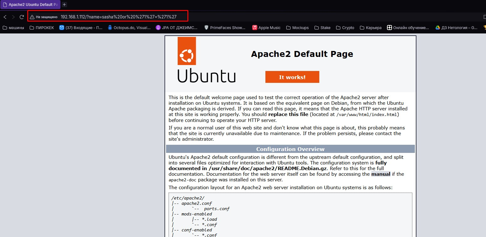
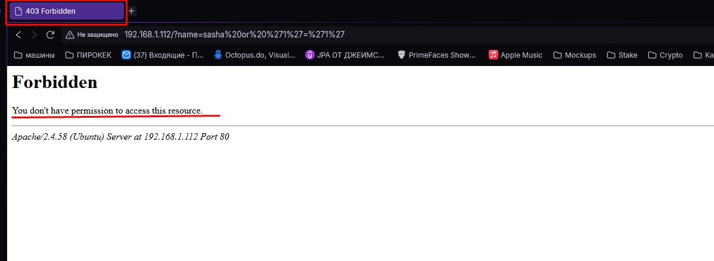

# Домашнее задание к занятию "WAF"

### Задание 1
Поставил на Ubuntu сервер Apache  
Машинка с Ubuntu виртуальная, сетевой интерфейс bridge поэтому спокойно подключаемся к ней с хостовой машины по IP  

Проверяем что Apache работает
  

Пробуем выполнить SQL-инъекцию и видим, что веб-сервер никак не сопротивляется
  

После настройки WAF ModeSecurity SQL-инъекция блокируется  
 

