# Домашнее задание к занятию "Популярные языки, системы сборки, управления зависимостями"

### Задание 1
Отправьте в личном кабинете студента ответы на следующие вопросы:
- Какие баги были выявлены: количество, описание, почему SonarQube их считает багами? См. ссылку Why is this an issue?.  
- Какие уязвимости были выявлены: количество, категории, описание, почему SonarQube их считает уязвимостями?
- Какие Security Hotspots были выявлены: количество, категории, приоритет, описание, почему SonarQube их считает Security HotSpot'ами?
- К каким CWE идёт отсылка для Security Hotspots из п. 2?
- Какие запахи кода были выявлены: количество, описание, почему SonarQube их считает запахами кода?

### Решение 1

Анализ проводился для проекта `ibdev` (ветка `master`, файл `src/main/java/ru/netology/Main.java`). Общая сводка по проекту показывает наличие 1 бага, 1 уязвимости, 1 Security Hotspot (0.0% проверено) и 5 запахов кода.

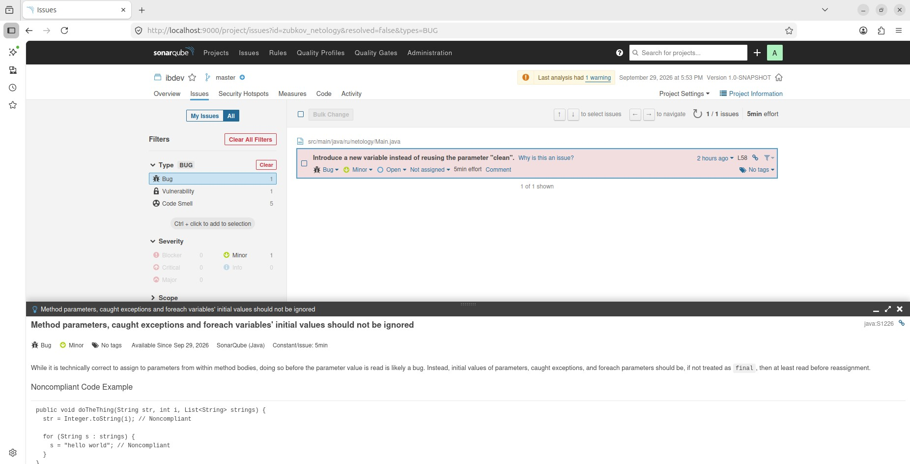

---

### 1. Баги (Bugs)
**Количество:** 1  
**Описание:** *Introduce a new variable instead of reusing the parameter 'clean'* (Правило `java:S1226`).  
**Почему SonarQube считает это багом:** Согласно правилу «Method parameters, caught exceptions and foreach variables' initial values should not be ignored», присвоение нового значения параметру метода до того, как его начальное значение было прочитано, с высокой вероятностью является логической ошибкой. Это может привести к тому, что исходные данные, переданные в метод, будут потеряны, а логика работы нарушена.

---

### 2. Уязвимости (Vulnerabilities)
**Количество:** 1  
**Категории:** Security, CWE, OWASP-A3 (Sensitive Data Exposure).  
**Описание:** *Databases should be password-protected* (Правило `java:S2115`). В коде обнаружено подключение к базе данных с пустым паролем.  
**Почему SonarQube считает это уязвимостью:** Базы данных должны быть защищены паролем. Использование подключения с пустым паролем является явным признаком того, что база данных не защищена. Это позволяет злоумышленникам получить несанкционированный доступ к данным, что нарушает требования безопасности (CWE-521 - Weak Password Requirements) и приводит к утечке конфиденциальной информации.

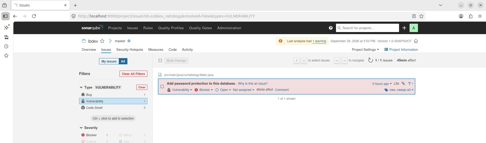  
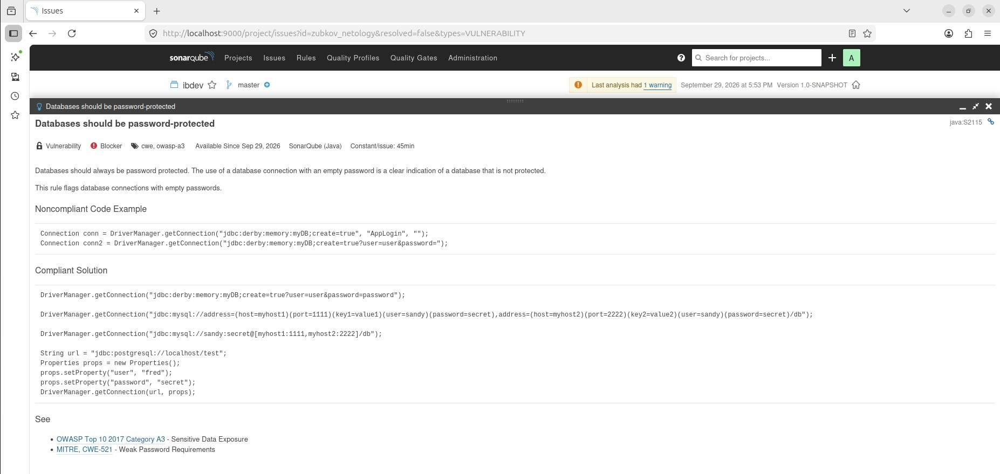
---

### 3. Security Hotspots
**Количество:** 1  
**Категории:** Insecure Configuration (Небезопасная конфигурация).  
**Приоритет:** LOW (Низкий).  
**Описание:** *Make sure this debug feature is deactivated before delivering the code in production.* (Убедитесь, что функция отладки отключена перед выпуском кода в production).  
**Почему SonarQube считает это Security HotSpot:** Security Hotspot — это не обязательно уязвимость, а участок кода, требующий ручной проверки. Использование отладочных функций (например, `e.printStackTrace()` или включенный режим отладки в Spring Security `@EnableWebSecurity(debug = true)`) в production-среде может привести к раскрытию чувствительной информации: структуры системы, версий библиотек, стеков вызовов и данных пользователей. Злоумышленники могут использовать эту информацию для дальнейших атак. Требуется ручная проверка, чтобы убедиться, что отладка отключена в боевой среде.

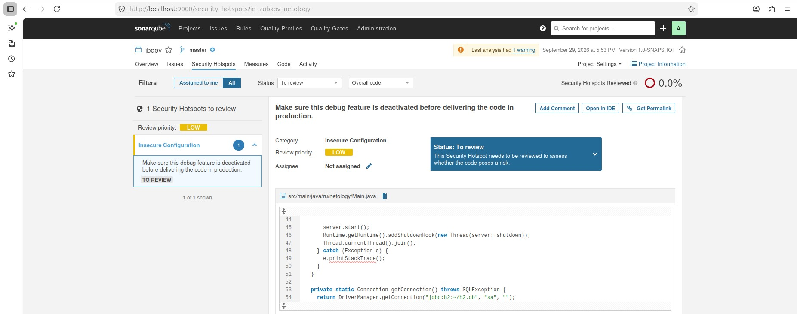  
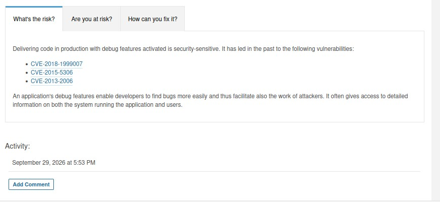  

---

### 4. Ссылки на CWE для Security Hotspots
В нижней части страницы правила (вкладка «How can you fix it?») для данного Security Hotspot указаны следующие отсылки к CWE:
- **MITRE CWE-489:** Leftover Debug Code (Оставшийся отладочный код).
- **MITRE CWE-215:** Information Exposure Through Debug Information (Раскрытие информации через отладочную информацию).

Также в разделе «See» указана отсылка к OWASP Top 10 2017 Category A3 - Sensitive Data Exposure.

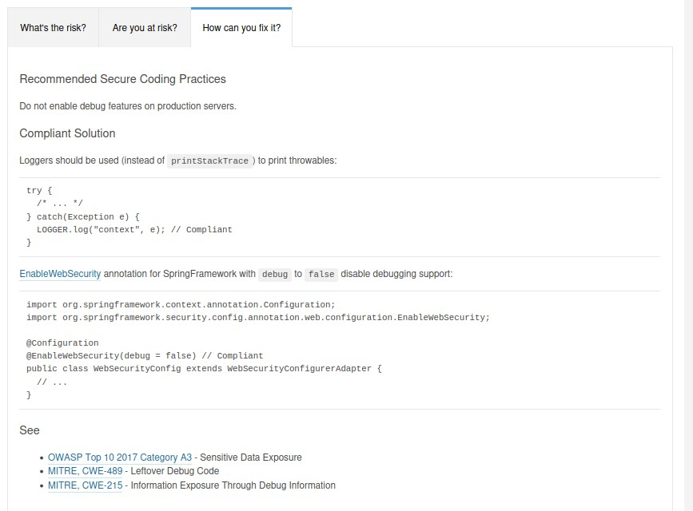

---

### 5. Запахи кода (Code Smells)
**Количество:** 5  

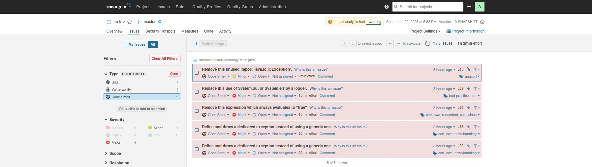

**1. Неиспользуемые импорты должны быть удалены**  
*Описание:* Наличие импортов `java.lang.*`, классов из того же пакета или вовсе неиспользуемых классов (Правило `java:S1128`).  
*Почему это запах кода:* Неиспользуемые импорты снижают читаемость кода, создают визуальный шум и могут вводить в заблуждение других разработчиков, заставляя их думать, что класс используется.    

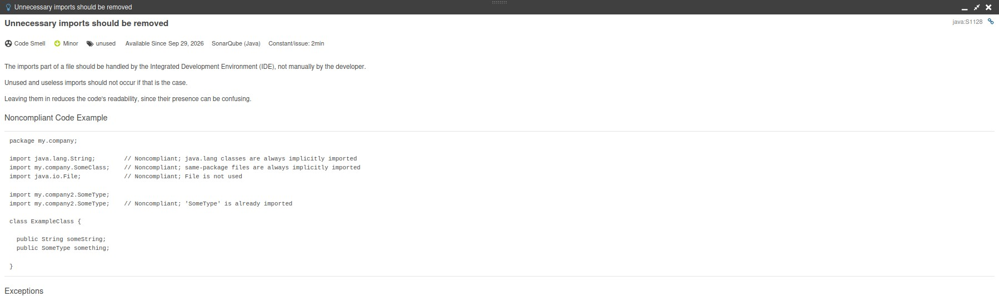 

**2. Стандартные потоки вывода не должны использоваться для логирования**  
*Описание:* В коде используется `System.out.println("My Message")` для вывода сообщений. Рекомендуется заменить это на вызов специализированного логгера, например: `logger.log("My Message")` (Правило `java:S106`).  
*Почему это запах кода:* Прямая запись в стандартные потоки вывода не позволяет гибко управлять логами: фильтровать их, менять формат, безопасно логировать конфиденциальные данные или гарантировать их фактическую запись. Рекомендуется использовать специализированные логгеры (`logger.log`).    

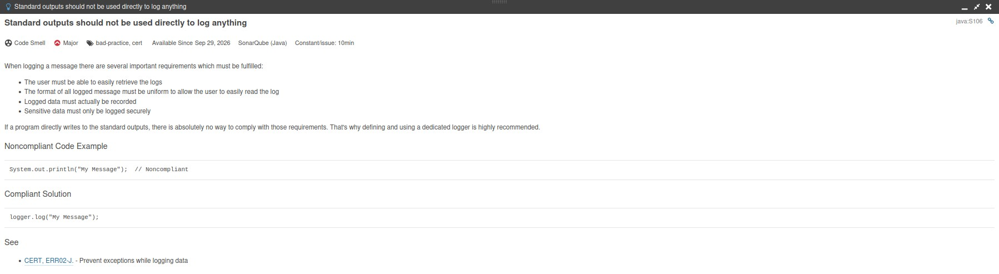  

**3. Булевы выражения не должны быть избыточными**  
*Описание:* Использование выражений, которые всегда истинны или ложны, например `if (b && a)`, где `a` всегда `true` (Правило `java:S2598`).  
*Почему это запах кода:* Такие выражения не меняют результат вычисления условия, делают код запутанным и могут указывать на логическую ошибку или невнимательность программиста.  

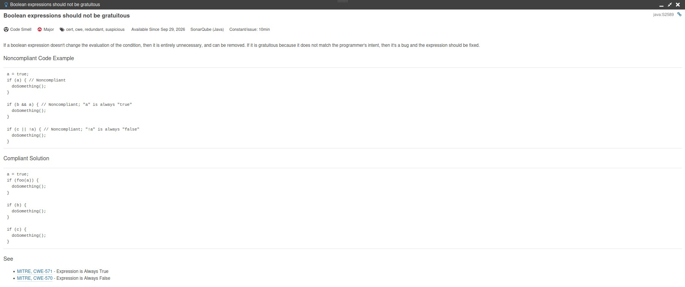  

 

**4. 5. Генерические исключения не должны выбрасываться (2 случая)**  
*Описание:* В коде выбрасываются общие исключения, такие как `throw new RuntimeException("My Message")` (Правило `java:S112`).  
*Почему это запах кода:* Выброс общих исключений (таких как `Error`, `RuntimeException`, `Throwable`, `Exception`) не позволяет вызывающему коду корректно обрабатывать конкретные типы ошибок. Это размывает абстракцию и затрудняет отладку. Следует создавать собственные классы исключений (`MyOwnRuntimeException`).  

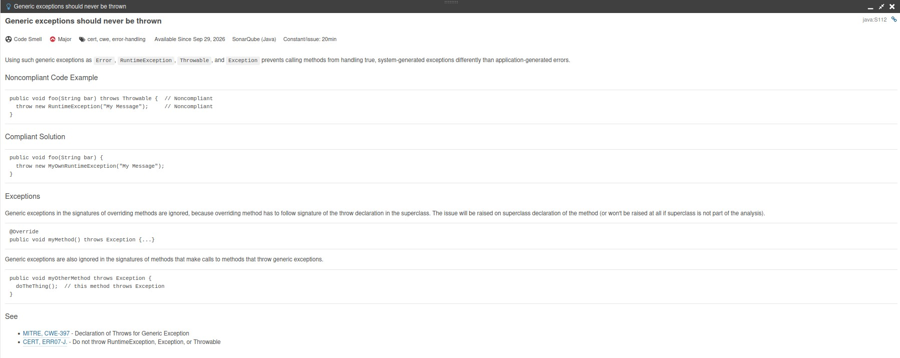  

---
